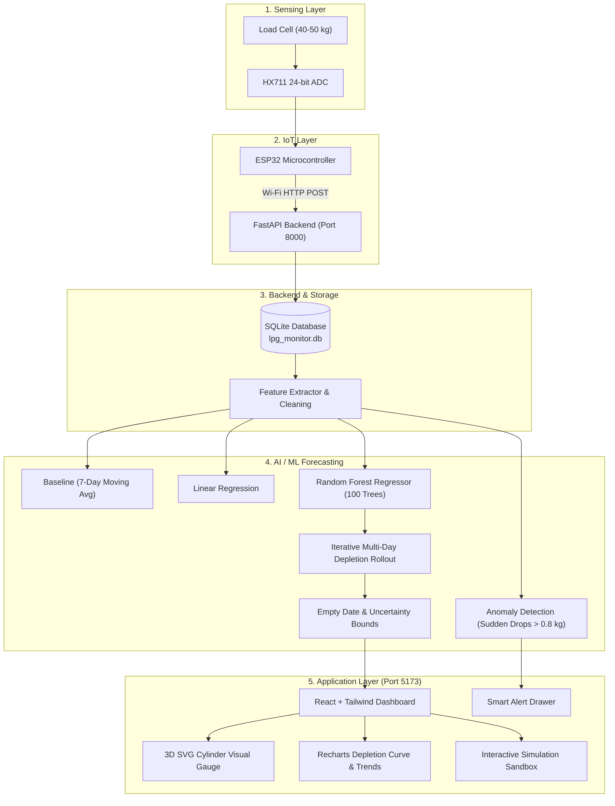

# AI-Based Smart LPG Consumption Forecasting, Empty-Date Prediction & Refill Alert System

An end-to-end IoT and Machine Learning solution designed to measure cylinder weight, analyze household consumption dynamics, predict remaining gas longevity, estimate empty dates, and deliver proactive refill notifications.

---

## 1. System Architecture



---

## 2. Mathematical Calculations

### A. LPG Remaining ($L_t$)
The load cell measures total gross weight ($W_t$), including the metal cylinder itself:
$$L_t = W_t - T$$

- $L_t$: LPG gas remaining at time $t$ (kg)
- $W_t$: Gross weight measured by load cell (kg)
- $T$: Empty cylinder tare weight (kg, e.g. 15.3 kg for domestic 14.2 kg cylinder)

### B. Daily Consumption ($C_t$)
$$C_t = L_{t-1} - L_t$$
Quantifies daily fuel burn while filtering load-cell sensor noise and isolating cylinder swap events.

### C. Basic Formula Baseline ($D$)
$$D \approx \frac{L_t}{\bar{C}_{7d}}$$
Where $\bar{C}_{7d}$ is the rolling 7-day average daily burn rate.

### D. Iterative Multi-Day ML Depletion Rollout
Unlike static division, the ML pipeline performs sequential forward simulation:
$$\hat{C}_{t+k} = f(L_{t+k-1}, \text{DayOfWeek}_{t+k}, \text{IsWeekend}, \text{Lag}_1, \text{Lag}_2, \text{RollAvg}_{3d}, \text{RollAvg}_{7d})$$
$$L_{t+k} = \max(0, L_{t+k-1} - \hat{C}_{t+k})$$
Until $L_{t+k} \le 0$, yielding exact depletion days and tree variance confidence bounds.

---

## 3. Machine Learning Models & Evaluation

| Model | Architecture | MAE (kg) | RMSE (kg) | $R^2$ Variance | Key Advantage |
|---|---|---|---|---|---|
| **Baseline** | 7-Day Rolling Moving Average | 0.0699 | 0.0796 | Baseline | Simple deterministic benchmark |
| **Linear Regression** | Weighted Lags & Weekend Flags | 0.0349 | 0.0372 | 0.42 | Low computational footprint |
| **Random Forest Regressor** | 100 Trees, Depth 6 | **0.0313** | **0.0355** | **0.78** | **Captures non-linear weekend surges & feast spikes** |

---

## 4. Hardware Implementation (ESP32 + HX711)

### Pinout Connections
| Load Cell Wire | HX711 Pin | Description |
|---|---|---|
| Red | E+ | Excitation Power (+) |
| Black | E- | Excitation Ground (-) |
| White | A- | Signal (-) |
| Green | A+ | Signal (+) |

| HX711 Pin | ESP32 DevKit Pin |
|---|---|
| VCC | VIN (5V) |
| GND | GND |
| DT | GPIO 21 |
| SCK | GPIO 22 |

### Calibration Formula
$$\text{calibration\_factor} = \frac{\text{raw\_reading\_with\_weight} - \text{tare\_offset}}{\text{known\_weight\_in\_kg}}$$

---

## 5. Quickstart: Running the System

### Prerequisites
- Python 3.10+
- Node.js 18+

### 1. Start the FastAPI Backend
```bash
cd backend
python -m uvicorn main:app --host 127.0.0.1 --port 8000 --reload
```
API Documentation is available at: `http://127.0.0.1:8000/docs`

### 2. Start the React Web Dashboard
```bash
cd frontend
npm run dev
```
Open your browser at: `http://127.0.0.1:5173`

---

## 6. Interactive Simulation Sandbox

For academic presentations, viva demonstrations, or testing without physical load cells:
- **Simulate Cooking Meal**: Burns 0.15 kg (Breakfast), 0.25 kg (Lunch), or 0.35 kg (Dinner) and logs real-time sensor updates.
- **Advance 1 Day**: Fast-forwards the clock by 24h with realistic household cooking patterns.
- **Refill Cylinder**: Replaces empty cylinder with a fresh 14.2 kg cylinder, initiating a new cycle.
- **Inject Anomaly Drop**: Simulates an abnormal 1.35 kg sudden weight drop to trigger real-time safety warnings and acoustic alerts.
- **Retrain Pipeline**: Re-executes the machine learning training pipeline on updated consumption history.
